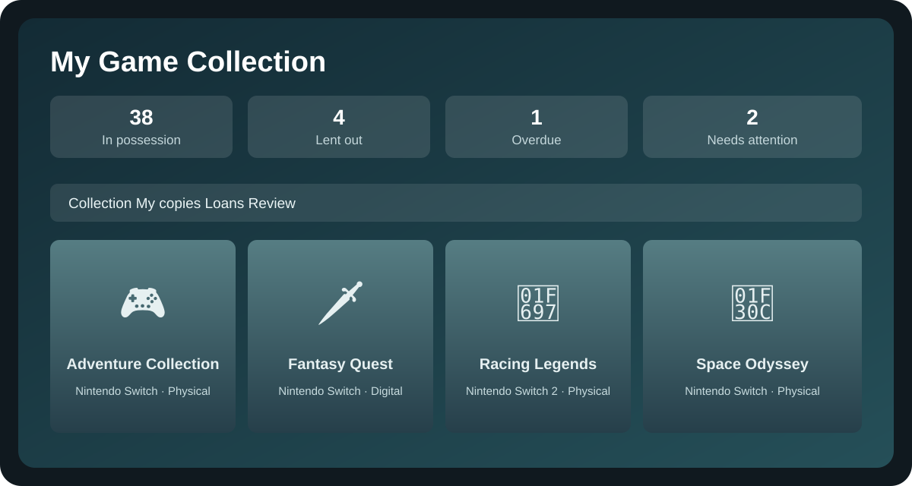

# DekuDeals Card for Home Assistant

A responsive Lovelace custom card for the [DekuDeals Home Assistant integration](https://github.com/kraroed/ha-dekudeals). Browse your imported game collection with cover art and descriptions, and keep an eye on physical copies, active loans, overdue returns, and inventory review items.

**Release: 0.6.1**

Version 0.6.1 replaces failed remote cover images with an accessible “Cover art unavailable” placeholder, preventing broken-image icons from appearing in the game grid.




## Features

- Three collection layouts: the existing cover-art grid, a touch-friendly horizontal carousel, and expandable collapsed groups.
- Collapsed groups can be organized by platform or alphabetically (A–Z).
- Long game descriptions are compact by default, with a two-line preview and a click-to-expand **Read more / Show less** control; expanded descriptions remain open through card refreshes when their game is still present.
- Manual **Refresh collection** button to request an immediate integration refresh.
- Portrait 2:3 cover-art grid using the integration's `image` and genuine item `description` attributes; artwork uses contain sizing without cropping or stretching.
- Console-specific, original portrait placeholders when cover art is missing, with distinct styling for Nintendo, PlayStation, Xbox, and PC platforms plus a neutral fallback.
- Separate Games and DLC views, including DLC counts and parent-game metadata when available.
- Search by game title and filter by every console/platform present in the configured collection, plus physical / digital format.
- Physical inventory view with copy status and active borrower.
- Register new physical copies directly from the card.
- Create loans directly from the Loans tab by selecting a physical copy, entering a borrower, and optionally setting a due date; return active loans from the same tab.
- Loan overview and collection reconciliation review actions.
- Responsive layout and Home Assistant theme variables.
- No external API calls, account credentials, or separate metadata fetching. All data comes from the integration's sensor attributes.

## Requirements

- Home Assistant with the [DekuDeals integration](https://github.com/kraroed/ha-dekudeals) installed and configured.
- A collection sensor exposing the `items` attribute.
- The **Total Physical Copies** sensor exposing the `copies` attribute.
- For lending and return actions, the integration's services must be loaded.

The integration currently exposes six collection sensors and eight inventory sensors. Home Assistant generates entity IDs based on your instance's naming and existing entities, so use the actual IDs shown under **Developer Tools → States**.

## Installation

### HACS (custom repository)

1. Open **HACS → Frontend**.
2. Open the three-dot menu and choose **Custom repositories**.
3. Add `https://github.com/kraroed/lovelace-dekudeals-card` and select **Dashboard** (frontend plugin) as the category.
4. Install **DekuDeals Card**.
5. If HACS does not automatically add the resource, add it under **Settings → Dashboards → Resources**:
   - URL: `/hacsfiles/lovelace-dekudeals-card/dekudeals-card.js`
   - Resource type: **JavaScript Module**
6. Refresh the browser after installation.

### Manual

Copy `dekudeals-card.js` into your Home Assistant `www` directory and add it as a JavaScript Module dashboard resource.

## Configuration

Add a **Manual card** to a dashboard and use the following YAML. Replace the example entity IDs with the IDs from your own Home Assistant instance.

```yaml
type: custom:dekudeals-card
title: My Game Collection
collection_entity: sensor.dekudeals_games
inventory_entity: sensor.dekudeals_total_physical_copies
lent_out_entity: sensor.dekudeals_games_lent_out
overdue_entity: sensor.dekudeals_games_overdue
needs_review_entity: sensor.dekudeals_inventory_needs_review
unmatched_entity: sensor.dekudeals_unmatched_physical_games
columns: 4
show_descriptions: true
show_inventory: true
view_mode: grid # grid, carousel, or collapsed
collapsed_grouping: platform # platform or alphabetical
```

The collection entity must expose an `items` array. The inventory entity must expose a `copies` array. The example entity IDs are illustrative only; HA may generate different IDs. If you have more than one DekuDeals config entry, set `config_entry_id` to the intended entry ID so service actions target the correct collection.

### Options

| Option | Required | Default | Description |
|---|---:|---|---|
| `collection_entity` | Yes | — | Collection sensor with the `items` attribute |
| `inventory_entity` | Yes | — | Total Physical Copies sensor with the `copies` attribute |
| `lent_out_entity` | No | — | Games Lent Out sensor, used for the summary count |
| `overdue_entity` | No | — | Games Overdue sensor |
| `needs_review_entity` | No | — | Inventory Needs Review sensor |
| `unmatched_entity` | No | — | Unmatched Physical Games sensor |
| `config_entry_id` | No | — | Specific integration config entry when multiple collections are configured |
| `title` | No | DekuDeals Collection | Card heading |
| `columns` | No | 4 | Collection grid columns (2–8) |
| `show_descriptions` | No | true | Show game descriptions under cover art; descriptions are collapsed by default and expandable |
| `show_inventory` | No | true | Show inventory, loans, and review tabs |
| `view_mode` | No | grid | Default collection layout: `grid`, `carousel`, or `collapsed` |
| `collapsed_grouping` | No | platform | Group collapsed items by `platform` or `alphabetical` |

## Using the card

- **Games / DLC:** switch between full games and DLC (including season passes and expansion packs identified by DekuDeals), then search by title and filter by any platform found in the collection and by format. Use the Grid, Carousel, and Collapsed controls to change layout; collapsed groups can be switched between platform and A–Z. Long descriptions show a short preview; select **Read more** to expand and **Show less** to collapse.
- **Refresh collection:** use the button in the card heading to ask the integration to refresh the collection immediately.
- **My copies:** register a physical copy, view registered copies, and select a copy before entering a borrower and optional due date. Choose **Lend selected copy** to record the loan.
- **Loans:** create a loan from the dedicated form at the top of the tab, then return an active loan with its **Return** button.
- **Review:** resolve reconciliation flags as **Present**, **Not present**, or **Manual**.

Borrower names and lending information are private local inventory data managed by the integration. The card displays them from the inventory sensor and submits service calls to Home Assistant; it does not send them to DekuDeals.

## Troubleshooting

- **Waiting for sensors:** confirm both required entity IDs exist and have the expected attributes in Developer Tools → States.
- **No cover art:** the card displays a platform-specific placeholder when the integration has no usable artwork URL. Real artwork is shown automatically when available.
- **Buttons do nothing:** confirm the DekuDeals integration is loaded and the relevant service exists under Developer Tools → Actions.
- **Wrong entity IDs:** entity IDs are assigned by Home Assistant and may differ from the examples above.

## Development

The card is a dependency-free JavaScript module. Run `node --check dekudeals-card.js` to check syntax. GitHub Actions runs this check and HACS plugin validation on pushes and pull requests.

## License

MIT. See [LICENSE](LICENSE).
